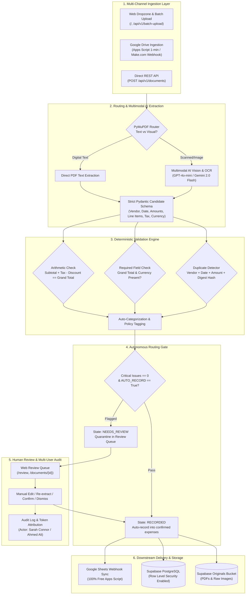

# Financial Document Assistant

A financial operations application for turning invoice and receipt files into reviewable expense records, tracking project spending, and synchronizing approved data with connected services.

---

## Architecture Overview



---

## Product capabilities

- **Flexible document intake:** Upload PDF, PNG, JPEG, and WebP invoices or receipts individually or in a batch. PDF inspection handles selectable text, scanned pages, and mixed text/image documents.
- **Structured extraction:** Capture vendor, date, invoice number, description, line items, subtotal, tax/VAT, discount, payable total, and currency using configured multimodal models such as OpenAI `gpt-4o-mini`.
- **Useful expense categories:** Classify spending into configurable project categories such as personnel, travel, equipment, software, events, and operations.
- **Validation with human control:** Flag missing totals or currency, arithmetic conflicts, and possible duplicates. Reviewers can inspect the source, correct fields, revalidate, confirm, or dismiss; unresolved records stay out of confirmed totals.
- **Trackable project finances:** Maintain confirmed expense records, filter and export the tracker, and summarize spend by project, category, month, and currency.
- **Unified reporting currencies:** Select USD, EUR, or EGP from the top bar. Totals, charts, timelines, and expense displays convert together while stored invoice values remain unchanged. Exchange-rate pairs, provider, and update date are shown for transparency; rates are for reporting, not settlement.
- **Connected workflows:** Google Drive intake and Google Sheets synchronization are available through Apps Script, with idempotent uploads and row updates/deletions. Apps Script quotas and external credentials still apply. A Make.com blueprint is also provided.
- **Operational safeguards:** Token-attributed actions, audit events, processing attempts, usage/cost estimates, bounded retries, and status views support investigation and routine operations.

The application can automatically record documents that pass its configured checks. Uncertain or inconsistent documents remain reviewable rather than being silently treated as confirmed expenses.

---

## Quickstart

### Prerequisites
- Python 3.12 or 3.13
- [`uv`](https://docs.astral.sh/uv/) package manager
- A Supabase PostgreSQL database (or compatible PostgreSQL instance)

### 1. Install Dependencies
```powershell
uv sync --locked
```

### 2. Configure Environment
Copy `.env.example` to `.env` and configure your credentials:
```powershell
Copy-Item .env.example .env
```

### 3. Initialize Database Schema
Run the database setup script to create tables, default projects (`river`, `skills`), default categories, and admin tokens:
```powershell
uv run python -m scripts.setup_db
```

### 4. Start the Application
```powershell
uv run uvicorn app.main:app --host 127.0.0.1 --port 8000
```
Open [http://127.0.0.1:8000](http://127.0.0.1:8000) in your browser.  
Sign in using your reviewer access token.

---

## Team Access Tokens & User Attribution

To allow team members to access the web app and attribute their actions in audit logs, manage tokens using [scripts/manage_tokens.py](scripts/manage_tokens.py):

```powershell
# 1. Create a token for a team member
uv run python scripts/manage_tokens.py create "Ahmed Ali" --role reviewer
uv run python scripts/manage_tokens.py create "Sarah Connor" --role reviewer

# 2. View all active team tokens
uv run python scripts/manage_tokens.py list

# 3. Revoke a token if a team member departs
uv run python scripts/manage_tokens.py revoke <token_string>
```

When Sarah Connor signs in using her token (`tok_sarah_connor_...`):
- Her web session is bound to `Sarah Connor`.
- Every invoice upload, confirmation, line-item edit, or deletion stores `actor: "Sarah Connor"` in the audit timeline.

---

## Cloud & Automation Integrations

### 1. Google Drive Ingestion (1-Minute Automated Polling + On-Demand)
- Located at [scripts/google_apps_script/DriveIngestion.gs](scripts/google_apps_script/DriveIngestion.gs).
- Automated cloud trigger runs every **1 minute** via `installDriveTrigger()`.
- Instant execution function `syncNow()` allows one-click runs from the Google Apps Script editor.
- Automatically computes SHA-256 idempotency keys; duplicate files or repeated runs are completely safe.

### 2. Make.com No-Code Scenario
- Import the pre-configured blueprint from [scripts/make/google_drive_to_finance_blueprint.json](scripts/make/google_drive_to_finance_blueprint.json).
- Downloads files from Google Drive and streams them directly as multipart/form-data to `/api/v1/documents`.

### 3. Google Sheets Sync
- Located at [scripts/google_apps_script/SheetsWebhook.gs](scripts/google_apps_script/SheetsWebhook.gs).
- Automatically writes and updates expenses in your Google Sheet under the **Expenses** tab.
- Handles retries, formula escaping, and currency values safely.

### 4. Hosting & Tunnel Switcher (ngrok / Render)
Switch public URLs by updating `HOSTING_PROVIDER` in `.env`:
- **ngrok**: Set `HOSTING_PROVIDER=ngrok` and run `uv run python scripts/start_tunnel.py` to launch your tunnel.
- **Render**: Set `HOSTING_PROVIDER=render` and provide `RENDER_URL=https://your-service.onrender.com`.

---

## Production Environment Variables Reference

| Variable | Description | Example / Allowed Values |
| :--- | :--- | :--- |
| `MODE` | Runtime mode | `cloud` |
| `DATABASE_URL` | PostgreSQL connection pooler URL | `postgresql+psycopg://postgres...:5432/postgres` |
| `SUPABASE_URL` | Supabase project URL | `https://xyz.supabase.co` |
| `STORAGE_BUCKET` | Storage bucket for original documents | `originals` |
| `REVIEWER_TOKEN` | Master administrative reviewer token | 24+ character secret token |
| `SESSION_SECRET` | Session cookie cryptographic signing secret | 24+ character secret |
| `SECURE_COOKIES` | Set to `true` when hosted over HTTPS | `false` (local) / `true` (HTTPS production) |
| `PROVIDER` | AI vision extraction provider | `openai` or `gemini` |
| `MODEL_NAME` | Model identifier | `gpt-4o-mini` or `gemini-2.0-flash` |
| `OPENAI_API_KEY` | OpenAI API key | `sk-proj-...` |
| `GOOGLE_API_KEY` | Google AI API key | `AQ....` |
| `AUTO_RECORD` | Automatically record valid documents | `true` |
| `SHEETS_WEBHOOK_URL`| Google Apps Script Web App URL | `https://script.google.com/macros/s/.../exec` |
| `SHEETS_WEBHOOK_SECRET` | Secret key matching the Apps Script property | Secret token string |
| `HOSTING_PROVIDER` | Public webhook target switcher | `ngrok`, `render`, or `local` |
| `NGROK_URL` | Public ngrok tunnel URL | `https://your-domain.ngrok-free.dev` |
| `RENDER_URL` | Public Render domain URL | `https://your-service.onrender.com` |

---

## Core API Endpoints Reference

All endpoints require `Authorization: Bearer <TOKEN>`:

| Method | Endpoint | Description |
| :--- | :--- | :--- |
| `POST` | `/api/v1/documents` | Upload and process single receipt/invoice (multipart: `file`, `project_id`, `auto_record`) |
| `POST` | `/api/v1/batch-upload` | Sequential batch upload for multiple files |
| `GET` | `/api/v1/documents/{id}` | Retrieve document extraction state, candidate, and review issues |
| `PATCH`| `/api/v1/documents/{id}/fields` | Update extracted candidate fields and rerun deterministic validation |
| `POST` | `/api/v1/documents/{id}/confirm` | Confirm candidate into an authoritative `Expense` record and sync to Sheets |
| `POST` | `/api/v1/documents/{id}/dismiss` | Dismiss document from active processing |
| `DELETE`| `/api/v1/documents/{id}` | Permanently delete document and its associated records |
| `GET` | `/api/v1/expenses` | Query confirmed expenses (`sort_by=date|added|amount`, `project`, `category`) |
| `GET` | `/api/v1/exchange-rates` | Authenticated latest daily exchange rates for supported reporting currencies (USD, EUR, EGP); accepts `base` and `symbols` |
| `POST` | `/api/v1/projects` | Create a new project (`id`, `name`) |
| `GET` | `/api/v1/projects` | List all projects |
| `POST` | `/api/v1/tokens` | Generate personal access token for a team member |
| `GET` | `/api/v1/tokens` | List team access tokens |
| `DELETE`| `/api/v1/tokens/{id}` | Revoke a team access token |

---

## Test Verification

Run the full automated test suite (all unit tests, integration tests, validation gates, and oracle benchmarks):

```powershell
uv run python -m pytest
```
*Result: 74 passed in the local offline suite. External provider and Google-account behavior requires separate configuration and live verification.*
