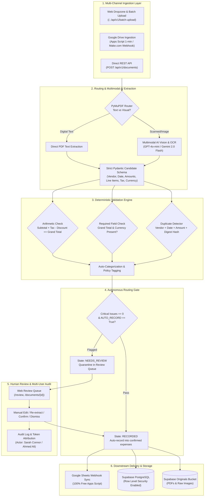

# Financial Document Assistant

An automated, production-grade financial operations platform designed for multi-format receipt and invoice ingestion, multimodal AI vision extraction, deterministic mathematical and policy validation, autonomous recording gates, multi-user audit logging, and bi-directional cloud integrations (Google Sheets, Google Drive, Make.com).

---

## Architecture Overview



---

## Key Features

1. **Autonomous Processing with Strict Safety Gates**:
   - Clean, valid invoices automatically process from ingestion to confirmed expense records and Google Sheets sync with **zero manual friction**.
   - Human review is strictly quarantined to **4 non-negotiable safety conditions**:
     - `MISSING_GRAND_TOTAL`: Grand total could not be determined.
     - `MISSING_CURRENCY`: Currency could not be determined or is ambiguous.
     - `POSSIBLE_DUPLICATE`: Matches an existing document by vendor, date, amount, or file digest.
     - `TOTAL_INCONSISTENCY`: Subtotal + tax - discount does not equal the grand total.
2. **Multi-User Access Tokens & Action Attribution**:
   - Issue distinct access tokens tied to team members (e.g. `Ahmed Ali`, `Sarah Connor`).
   - Every action—uploading documents, editing line items, approving expenses, modifying categories, or deleting records—is permanently recorded in the audit log with the user's name.
3. **Multi-Format Ingestion**:
   - Supports PDF, PNG, JPEG, and WEBP.
   - Batch upload interface processes documents sequentially in an isolated queue with live visual progress.
4. **Enhanced Data Visualizations**:
   - Dynamic Doughnut/Pie chart with exact dollar amounts and percentages rendered directly on each slice.
   - Interactive, instant table sorting by **Invoice Date**, **Date Added to Project**, **Vendor**, and **Amount**.
5. **No-Paywall Cloud Automations**:
   - **Google Drive**: Background Apps Script polling every **1 minute** + instant one-click sync, plus ready-to-use Make.com scenario blueprint.
   - **Google Sheets**: Free bidirectional webhook integration updating spreadsheet rows without Google API quota limits or Zapier subscription fees.
   - **Tunnel & Hosting Switcher**: Built-in switcher between **Render** and **ngrok** via `.env`.

---

## Quickstart

### Prerequisites
- Python 3.12 or 3.13
- [`uv`](https://docs.astral.sh/uv/) package manager
- A Supabase PostgreSQL database (or compatible PostgreSQL instance)

### 1. Install Dependencies
```powershell
uv sync --locked
```

### 2. Configure Environment
Copy `.env.example` to `.env` and configure your credentials:
```powershell
Copy-Item .env.example .env
```

### 3. Initialize Database Schema
Run the database setup script to create tables, default projects (`river`, `skills`), default categories, and admin tokens:
```powershell
uv run python -m scripts.setup_db
```

### 4. Start the Application
```powershell
uv run uvicorn app.main:app --host 127.0.0.1 --port 8000
```
Open [http://127.0.0.1:8000](http://127.0.0.1:8000) in your browser.  
Sign in using your reviewer access token.

---

## How to Create and Manage Projects (Like `river`)

Projects isolate budgets, expense records, categories, and documents. The system comes pre-seeded with project `river` and `skills`. Here is how you create new projects:

### Method A: Through the Web Interface (Recommended)
1. In the left navigation sidebar, click **Projects** (`/projects`).
2. Under **Create a project**, fill in:
   - **Project name**: The human-readable title (e.g., `Solar Microgrid Initiative` or `Community Water Fund`).
   - **Permanent project ID**: Lowercase alphanumeric slug with hyphens or underscores (e.g., `solar-microgrid` or `community-water`).
3. Click **Create project**.
4. The project is immediately available in the upload dropzone, review filters, and expense tracker.

### Method B: Via Authenticated REST API
Send an authenticated `POST` request to `/api/v1/projects`:
```bash
curl -X POST http://127.0.0.1:8000/api/v1/projects \
  -H "Authorization: Bearer <YOUR_REVIEWER_TOKEN>" \
  -H "Content-Type: application/json" \
  -d '{
    "id": "solar-microgrid",
    "name": "Solar Microgrid Initiative"
  }'
```
Response (`201 Created`):
```json
{
  "id": "solar-microgrid",
  "name": "Solar Microgrid Initiative"
}
```

### Method C: Via Direct SQL (Supabase SQL Editor)
```sql
INSERT INTO projects (id, name, created_at)
VALUES ('solar-microgrid', 'Solar Microgrid Initiative', NOW())
ON CONFLICT (id) DO NOTHING;
```

### Using Your New Project in Automations:
- **Web UI Dropzone**: Select `Solar Microgrid Initiative` from the Project dropdown before dropping files.
- **Google Drive Apps Script**: In `DriveIngestion.gs`, set Script Property `PROJECT_ID = "solar-microgrid"`.
- **Make.com**: In the HTTP module multipart fields, set `project_id = "solar-microgrid"`.

---

## Team Access Tokens & User Attribution

To allow team members to access the web app and attribute their actions in audit logs, manage tokens using [scripts/manage_tokens.py](file:///D:/ImpactCircles/Financial-Document-Processer/scripts/manage_tokens.py):

```powershell
# 1. Create a token for a team member
uv run python scripts/manage_tokens.py create "Ahmed Ali" --role reviewer
uv run python scripts/manage_tokens.py create "Sarah Connor" --role reviewer

# 2. View all active team tokens
uv run python scripts/manage_tokens.py list

# 3. Revoke a token if a team member departs
uv run python scripts/manage_tokens.py revoke <token_string>
```

When Sarah Connor signs in using her token (`tok_sarah_connor_...`):
- Her web session is bound to `Sarah Connor`.
- Every invoice upload, confirmation, line-item edit, or deletion stores `actor: "Sarah Connor"` in the audit timeline.

---

## Cloud & Automation Integrations

### 1. Google Drive Ingestion (1-Minute Automated Polling + On-Demand)
- Located at [scripts/google_apps_script/DriveIngestion.gs](file:///D:/ImpactCircles/Financial-Document-Processer/scripts/google_apps_script/DriveIngestion.gs).
- Automated cloud trigger runs every **1 minute** via `installDriveTrigger()`.
- Instant execution function `syncNow()` allows one-click runs from the Google Apps Script editor.
- Automatically computes SHA-256 idempotency keys; duplicate files or repeated runs are completely safe.

### 2. Make.com No-Code Scenario
- Import the pre-configured blueprint from [scripts/make/google_drive_to_finance_blueprint.json](file:///D:/ImpactCircles/Financial-Document-Processer/scripts/make/google_drive_to_finance_blueprint.json).
- Downloads files from Google Drive and streams them directly as multipart/form-data to `/api/v1/documents`.

### 3. Google Sheets Outbound Sync
- Located at [scripts/google_apps_script/SheetsWebhook.gs](file:///D:/ImpactCircles/Financial-Document-Processer/scripts/google_apps_script/SheetsWebhook.gs).
- Automatically writes and updates expenses in your Google Sheet under the **Expenses** tab.
- Handles retries, formula escaping, and currency values safely.

### 4. Hosting & Tunnel Switcher (ngrok / Render)
Switch public URLs by updating `HOSTING_PROVIDER` in `.env`:
- **ngrok**: Set `HOSTING_PROVIDER=ngrok` and run `uv run python scripts/start_tunnel.py` to launch your tunnel.
- **Render**: Set `HOSTING_PROVIDER=render` and provide `RENDER_URL=https://your-service.onrender.com`.

---

## Production Environment Variables Reference

| Variable | Description | Example / Allowed Values |
| :--- | :--- | :--- |
| `MODE` | Runtime mode | `cloud` |
| `DATABASE_URL` | PostgreSQL connection pooler URL | `postgresql+psycopg://postgres...:5432/postgres` |
| `SUPABASE_URL` | Supabase project URL | `https://xyz.supabase.co` |
| `STORAGE_BUCKET` | Storage bucket for original documents | `originals` |
| `REVIEWER_TOKEN` | Master administrative reviewer token | 24+ character secret token |
| `SESSION_SECRET` | Session cookie cryptographic signing secret | 24+ character secret |
| `SECURE_COOKIES` | Set to `true` when hosted over HTTPS | `false` (local) / `true` (HTTPS production) |
| `PROVIDER` | AI vision extraction provider | `openai` or `gemini` |
| `MODEL_NAME` | Model identifier | `gpt-4o-mini` or `gemini-2.0-flash` |
| `OPENAI_API_KEY` | OpenAI API key | `sk-proj-...` |
| `GOOGLE_API_KEY` | Google AI API key | `AQ....` |
| `AUTO_RECORD` | Automatically record valid documents | `true` |
| `SHEETS_WEBHOOK_URL`| Google Apps Script Web App URL | `https://script.google.com/macros/s/.../exec` |
| `SHEETS_WEBHOOK_SECRET` | Secret key matching the Apps Script property | Secret token string |
| `HOSTING_PROVIDER` | Public webhook target switcher | `ngrok`, `render`, or `local` |
| `NGROK_URL` | Public ngrok tunnel URL | `https://your-domain.ngrok-free.dev` |
| `RENDER_URL` | Public Render domain URL | `https://your-service.onrender.com` |

---

## Core API Endpoints Reference

All endpoints require `Authorization: Bearer <TOKEN>`:

| Method | Endpoint | Description |
| :--- | :--- | :--- |
| `POST` | `/api/v1/documents` | Upload and process single receipt/invoice (multipart: `file`, `project_id`, `auto_record`) |
| `POST` | `/api/v1/batch-upload` | Sequential batch upload for multiple files |
| `GET` | `/api/v1/documents/{id}` | Retrieve document extraction state, candidate, and review issues |
| `PATCH`| `/api/v1/documents/{id}/fields` | Update extracted candidate fields and rerun deterministic validation |
| `POST` | `/api/v1/documents/{id}/confirm` | Confirm candidate into an authoritative `Expense` record and sync to Sheets |
| `POST` | `/api/v1/documents/{id}/dismiss` | Dismiss document from active processing |
| `DELETE`| `/api/v1/documents/{id}` | Permanently delete document and its associated records |
| `GET` | `/api/v1/expenses` | Query confirmed expenses (`sort_by=date|added|amount`, `project`, `category`) |
| `POST` | `/api/v1/projects` | Create a new project (`id`, `name`) |
| `GET` | `/api/v1/projects` | List all projects |
| `POST` | `/api/v1/tokens` | Generate personal access token for a team member |
| `GET` | `/api/v1/tokens` | List team access tokens |
| `DELETE`| `/api/v1/tokens/{id}` | Revoke a team access token |

---

## Test Verification

Run the full automated test suite (all unit tests, integration tests, validation gates, and oracle benchmarks):

```powershell
uv run python -m pytest
```
*Result: 72 passed (100%).*
