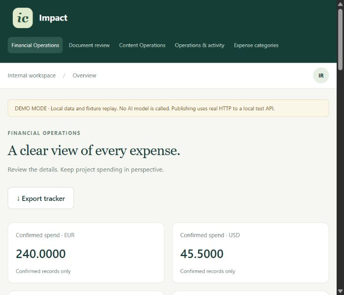

# Impact workspace

Review project expenses and publish project updates after explicit human approval.
One FastAPI/Jinja workspace contains **Financial Operations**, **Content Operations**,
and a correlated Operations feed. Only confirmed expenses enter currency-separated
totals. Only the exact approved content revision reaches the test publisher.

This is a prototype with fictional examples. Live AI, Supabase, Sheets and cloud
trace exporters have not been smoke-tested. See [verification](docs/verification.md).

## Two-minute offline quickstart

Install Python 3.12/3.13 and uv, then from this directory:

```powershell
uv sync
uv run python -m scripts.demo_setup
uv run uvicorn app.main:app --host 127.0.0.1 --port 8000
```

In a second terminal:

```powershell
uv run uvicorn app.publisher:app --host 127.0.0.1 --port 8011
```

Open [the workspace](http://127.0.0.1:8000). Open `.env` locally and copy its
`REVIEWER_TOKEN` into the sign-in field. Setup creates random secrets and preserves
an existing `.env`. It does not print credentials. If `.env` already exists, configure
it explicitly; the script will not overwrite it.

The offline demo uses SQLite/local originals and **known fixture replay**, not an
LLM. Every screen labels this mode. Use `tests/fixtures/digital.pdf`, `receipt.png`,
`missing-total.pdf`, and `mixed.pdf`. Unknown files fail clearly under fixture mode.
Content uses three distinct source-preserving templates in this mode. Publishing
still makes real HTTP requests to the separate local CMS/social test server.
No Impact Circles accounts are accessed.

Actual narrow-viewport dashboard capture from the running demo:



## Use the dashboard

1. **Financial Operations:** select a fictional project, upload a PDF/image, and open
   the extracted candidate. The project is chosen by you, never inferred by a model.
2. **Document review:** compare the original and extracted fields. Save corrections
   with **Edit & revalidate**. Confirm records only after checking the source.
   Duplicate/arithmetic overrides and dismissals require a justification. Missing
   amount/currency cannot be waived. Re-extract creates a separate attempt.
3. **Tracker:** filter by project/category/currency/date. Confirmed totals and category
   bars stay separate by currency. CSV export never includes unconfirmed records.
4. **Content Operations:** paste a project update; review the three drafts, select
   channels, edit, then **Save new revision**. Click **Approve & Publish** to send
   that revision to the test destinations. Open the resulting pages and log.
   Editing invalidates approval. Retry skips successful channels; each channel has
   at most three attempts. Previously published pages remain historical artifacts.
5. **Operations:** search exact run/request/document/content IDs for routing, validation,
   human decisions and HTTP integration events. Inspect timings and provider usage.

## Cloud setup (requires your own test project)

Copy `.env.example` to `.env`, configure `MODE=cloud`, a Supabase direct/session-pooler
`postgresql+psycopg://...` connection, `SUPABASE_URL` and server-only service key.
Generate distinct random reviewer/session/publisher secrets of at least 24 characters.
Use HTTPS and `SECURE_COOKIES=true` for a hosted deployment.

```powershell
uv sync --locked
uv run python -m scripts.setup_db
uv run uvicorn app.main:app --host 127.0.0.1 --port 8000
```

Run setup as the database owner against a dedicated test Supabase project. It
creates the schema, seeds stable categories/fictional projects, enables RLS on app
tables without public policies, and creates/forces a private `originals` bucket.
App access is server-side with a privileged DB role; anonymous browser access to
Supabase tables is not used. `supabase/migrations/001_initial.sql` is a reproducible
initial schema export, not an upgrade migration. Recreate it with
`uv run python -m scripts.export_schema`; later schema changes require migrations.
No cloud database migration or bucket creation was executed during local verification.

Supabase is authoritative in cloud mode; Sheets is an outbound projection. Free-tier
limits, pauses and network outages can interrupt service. Offline SQLite is a
demonstration/test path, not a replacement claim for a verified Supabase deployment.

## Models and bounded execution

Choose `PROVIDER=gemini|openai|xai` explicitly and set `MODEL_NAME` and the matching key.
No private file is silently sent to another provider. LangChain adapters normalize
structured outputs; finite LangGraph graphs organize extraction/drafting. Python
performs arithmetic, validation, state changes, DB writes and approvals.

| Adapter | Implemented route | Verification |
|---|---|---|
| Gemini / `langchain-google-genai` | Text and rendered page images; structured extraction/drafts | Imports verified; live call not run |
| OpenAI / `langchain-openai` | Text and rendered page images; structured extraction/drafts | Imports verified; live call not run |
| xAI / `langchain-xai` | Text extraction/categorization/drafting | Imports verified; images explicitly rejected; live call not run |
| Fixture | Ground-truth replay for known SHA-256 files; source-preserving draft templates | Tested offline; no AI inference |

The current [ChatXAI feature table](https://docs.langchain.com/oss/python/integrations/chat/xai)
marks image input unsupported. This application does not promise a separate xAI file
path. [Gemini](https://docs.langchain.com/oss/python/integrations/chat/google_generative_ai)
and [OpenAI](https://docs.langchain.com/oss/python/integrations/chat/openai) documentation
describe image/structured output support; installed imports do not prove live model access.

Maximum three calls per finance attempt (extract, categorize, at most one corrective
retry within the budget). SDK retries are disabled; wrapper permits one retry per
operation within the shared three-call limit, with 200 ms backoff and configured
timeout. Re-extraction is human initiated. Page, pixel, byte and text limits are enforced.
Mixed/uncertain PDFs render all pages; no local OCR engine is installed.

Live calls require model-specific `INPUT_USD_PER_MILLION`, `OUTPUT_USD_PER_MILLION`,
`PRICING_SOURCE_URL` and `PRICING_CHECKED_AT`. Check the selected model's current
official rates yourself before configuring. The guard reserves a conservative
`MAX_INPUT_TOKENS` + 2048 output tokens per call against `MAX_JOB_COST_USD`.
Choose a context ceiling adequate for the model's image accounting; the application
cannot guarantee a provider invoice maximum. Models with separate image/file charges
need a verified rate policy before use. Missing rates block live calls; missing usage
remains unknown. Cached tokens are recorded when reported; estimates conservatively
apply the input rate without a cached discount. Provider invoices are not available.

## Financial rules

Money is Decimal throughout the domain, decimal strings in JSON and PostgreSQL
NUMERIC(20,4). Refunds/credit notes and negative components are rejected as outside
the prototype scope. Grand total is distinct from amount due/paid. Zero/missing total
and unknown currency block confirmation. Missing optional invoice number, VAT,
discount or items alone never trigger review. Vendor/date absence and implausible
dates are nonblocking warnings under a provisional demo policy.

The four review gates are `MISSING_GRAND_TOTAL`, `MISSING_CURRENCY`,
`POSSIBLE_DUPLICATE`, `TOTAL_INCONSISTENCY`. Arithmetic tolerance is 0.02 currency
units; subtotal/discount/tax treatment must be explicitly labeled before comparison.
Unknown tax treatment or ambiguous discount scope is not guessed. Date/currency
syntax and bounded exact money are schema-validated.

SHA-256 uniqueness prevents duplicate submissions from creating second expenses.
Normalized vendor + document number and vendor/date/amount/currency comparisons run
on every candidate. Explicit disjoint item descriptions can reduce weak same-day
matches; no items are invented. Potential duplicates require review, not rejection.
Confirmation checks duplicates again under a small-team taxonomy lock on PostgreSQL,
uses a version compare-and-set and has a unique document-to-expense constraint.
PostgreSQL concurrency has not been tested against a running cloud database.

States: RECEIVED → PROCESSING → PROCESSED → NEEDS_REVIEW / READY_TO_RECORD → RECORDED;
FAILED and DISMISSED are distinct. Issues/history are retained. All confirmations
are human actions in this prototype; a model cannot record or publish anything.

## Integrations and API

[OpenAPI docs](http://127.0.0.1:8000/docs) describe request schemas. Protected endpoints
accept `Authorization: Bearer <REVIEWER_TOKEN>`. Browser sessions use HttpOnly,
SameSite=Strict cookies and a CSRF header. This is one internal reviewer identity,
not an identity provider or multitenant permission system.

```sh
curl -H "Authorization: Bearer $REVIEWER_TOKEN" \
  -H "Idempotency-Key: example-upload-001" \
  -F "project_id=river" -F "file=@tests/fixtures/digital.pdf" \
  http://127.0.0.1:8000/api/v1/documents
```

Zapier Webhooks can send the same authenticated multipart POST with Content-Length.
Processing is synchronous and bounded; the response includes document ID/state.
Poll `GET /api/v1/documents/{id}` for persisted status. An idempotency key reused with
different bytes/project returns 409. Exact files reuse the existing original project.

Other endpoints: `/api/v1/reviews`, `/api/v1/documents/{id}/fields` (PATCH),
`/{id}/confirm`, `/{id}/dismiss`, `/{id}/reextract` (POST under documents),
`/api/v1/expenses`, `/api/v1/expenses/summary`, `/api/v1/expenses.csv`,
`/api/v1/categories/{id}` (PATCH), `/api/v1/content` (POST),
`/api/v1/content/{id}` (GET/PUT), `/{id}/approve-and-publish`, `/{id}/retry`.

**Google Sheets:** create an `Expenses` tab and header row with
`id,project,category,vendor,date,description,total,currency`. Set
`SHEETS_SPREADSHEET_ID` and a test-user OAuth access token with Sheets scope, then
grant that user edit access. Tokens expire; refresh-token automation is not implemented.
Confirmation attempts sync once; retry via `POST /api/v1/expenses/{id}/sync`.
Each expense reserves a unique fixed row; PUT values.update overwrites that row on
retry (max three attempts). Do not manually reorder/delete projection rows. Source
records survive sync failure. Without credentials, the delivery stays pending with
`SHEETS_NOT_CONFIGURED`. Fake transport tests are not proof of a live Sheet.

**Test publishing:** `app.publisher` is a separate local mock website/social API.
HMAC-authenticated POST `/api/posts` stores posts idempotently and serves public-ish
`/posts/{key}` pages. The main app binds approval to drafts, channels, revision and
SHA-256 digest. It persists the human approval, locks/rechecks the current revision,
then sends HTTP. An edit before this check blocks publication; an edit during the
locked HTTP transaction waits. Crash retries use the same publication idempotency key.
Website, LinkedIn and newsletter are labeled test channels, not actual platform APIs.
Replace `Publisher` with an authorized CMS/social adapter implementing the same
contract; preserve approval checks and per-channel idempotency. No production adapter
or actual social permissions are claimed. Optional outbound webhooks are not implemented.

## Operations, tests and limits

One durable event feed stores request/run/resource IDs, route reasons, validation
codes, human actions, integration status, per-request measured query counts/latency,
slow-query counts and workflow duration. It never stores raw prompts or document
text in telemetry. Candidates and source facts live in protected domain records.
The usage ledger is counted once regardless of future trace exporters.

Langfuse and LangSmith exporters are **not implemented/verified**. Selecting an
exporter currently blocks live calls with `TRACE_EXPORTER_NOT_VERIFIED` to avoid
silently exporting private source data. `TRACING_BACKENDS=none` is supported. The
internal Operations view works without cloud tracing.

```powershell
uv run ruff check .
uv run pytest -q
```

Fixtures are fictional, labeled and versioned in `tests/fixtures/ground_truth.json`.
Tests use isolated SQLite, fake models and explicit fake transports, plus a real
loopback HTTP publisher test. They test workflow behavior, not live AI accuracy.
The demo does not establish an extraction benchmark or production readiness.
SQLite NUMERIC is only for small fixture values; production financial precision and
locking require PostgreSQL. No video is claimed until an actual recording exists.
Use [verification](docs/verification.md) for observed evidence and remaining gaps.

Uploads are bounded to 10 MB / eight pages / 25 million image pixels. Source files
are private and served only through authenticated routes. Demo secrets, databases,
uploads, caches, recordings and private assessment guidance are excluded from Git.
Stop both servers before archiving a demo; move `.env` and `data/` to a private backup
and rerun setup for a new empty demo. Never delete real cloud records as a demo reset.
